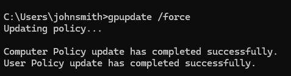
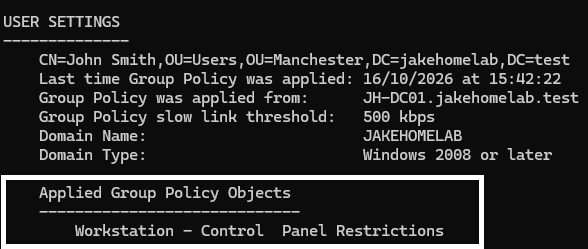

<h1>Employee Onboarding – Active Directory & Group Policy</h1>

<b>Project Overview</b>

This project demonstrates a simulated employee onboarding process using a Windows Server Active Directory domain and a Windows 11 client virtual machine. The objective was to configure a new workstation, connect it to the domain, create and manage an employee account, and apply Group Policy Objects (GPOs) to enforce organisational settings.

The lab was built using VMware Workstation Pro, Windows Server and Windows 11 to practise common IT support and systems administration tasks in a controlled environment.

<b>Objectives</b>

Configure DNS settings on a new Windows 11 workstation.

Join the workstation to the jakehomelab.test Active Directory domain.

Create and configure an employee account for John Smith.

Organise user accounts and security group memberships in Active Directory.

Configure a Group Policy Object to restrict access to Control Panel and PC Settings.

Refresh Group Policy and verify that the policy is applied to the intended user.

<b>Implementation</b>

1. Configure DNS on the Windows 11 Workstation

Configured the Windows 11 virtual machine to use the domain controller as its preferred DNS server, using the static address 192.168.193.10.

This ensures that the workstation can resolve internal domain records and locate Active Directory services required for domain authentication and Group Policy processing.

2. Join the Workstation to Active Directory

Joined the Windows 11 workstation, MAN-PC-001, to the jakehomelab.test domain.

This allows the workstation to authenticate domain users and receive centrally managed settings from the domain controller.

3. Create and Configure the Employee Account

Created the employee account for John Smith in Active Directory Users and Computers and configured the account's group memberships.

John Smith was added to the Domain Users group and the Finance security group to demonstrate how user accounts can be assigned organisational access through group membership.

4. Configure the Group Policy Object

Created a GPO named Workstation - Control Panel Restrictions and configured the policy:

User Configuration → Policies → Administrative Templates → Control Panel → Prohibit access to Control Panel and PC settings

Enabled the policy and linked the GPO to the Manchester/Users organisational unit (OU).

This demonstrates how user-based policies can be applied to accounts within a specific OU instead of configuring every workstation individually.

5. Refresh Group Policy

Signed in to the Windows 11 workstation as John Smith and ran the following command:

gpupdate /force

This forces Windows to refresh computer and user Group Policy settings from the applicable policy sources.

6. Verify Group Policy Application

Used the following command to inspect the resulting Group Policy settings:

gpresult /r

The output confirmed that Workstation - Control Panel Restrictions appeared under the applied Group Policy Objects for John Smith.

This verifies that the user account received the intended GPO from the domain environment.

<b>Skills Demonstrated</b>

Active Directory Domain Services (AD DS)

DNS configuration and domain name resolution

Windows 11 domain joining

User account creation and management

Security group membership

Organisational Units (OUs)

Group Policy creation, linking and configuration

Command-line troubleshooting with gpupdate and gpresult

Testing and validating centrally managed Windows settings

<b>Outcome</b>

Successfully configured a Windows 11 domain workstation, onboarded a simulated employee account and verified the application of a user-based Group Policy Object.

This project demonstrates a practical understanding of the relationship between DNS, Active Directory, domain authentication and Group Policy in a small Windows domain environment.
